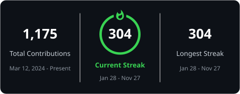
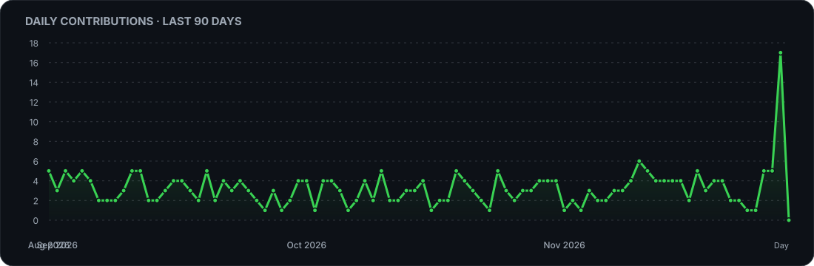
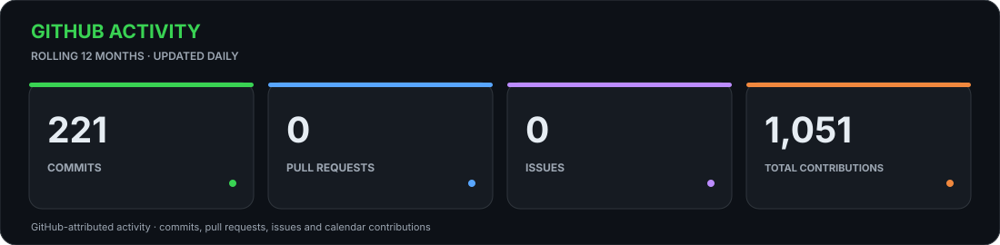
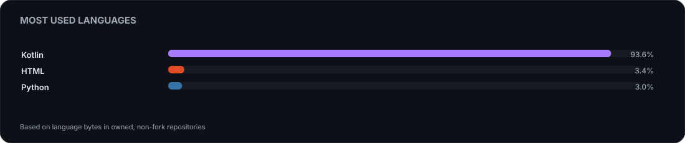

  
  
  

**Android Developer** focused on building maintainable, responsive mobile applications with **Kotlin** and **Jetpack Compose**.

I enjoy working on clean architecture, offline-first experiences, API integration, and practical product features. I use Java for data structures, algorithms, and problem-solving.

---

## 👨‍💻 About

- 🎓 MCA student at **GJUST**
- 📱 Focused on **Android development** and modern Kotlin
- 🧱 Interested in **Clean Architecture, MVVM, Coroutines, Flow, Room, and Hilt**
- 🧠 Practising data structures, algorithms, and problem-solving with Java
- 🚀 Building and improving real-world applications

## 🚀 Featured Projects

<table>
  <tr>
    <td width="33%" valign="top">
      <h3>🌐 ServerAlive</h3>
      
Android client for a real-time uptime monitoring platform, with monitoring dashboards, animated status heatmaps, and push notifications.

      
<strong>Stack</strong> Kotlin · Jetpack Compose · REST APIs · FCM

    </td>
    <td width="33%" valign="top">
      <h3>🧠 Revisely</h3>
      
Offline-first learning app with MCQs and revision tools, structured around clean architecture and locally persisted learning data.

      
<strong>Stack</strong> Kotlin · Compose · Room · Hilt · StateFlow

    </td>
    <td width="33%" valign="top">
      <h3>⚡ ZenLoad</h3>
      
Asynchronous media fetching experience with reactive progress updates and non-blocking I/O.

      
<strong>Stack</strong> Kotlin · Coroutines · Flow

    </td>
  </tr>
</table>

## 🛠️ Tech Stack

  

---

## 📊 GitHub Analytics

  <h3>🔥 Daily Contribution Streak</h3>
  
   
  Daily streak is calculated from GitHub profile contributions. It is not a weekly streak.

 

  <h3>📈 Contribution Activity · Last 90 Days</h3>
  

 

  <h3>📌 Commit & Repository Stats</h3>
  
  

Analytics images are refreshed daily by GitHub Actions. The streak and contribution calendar include qualifying GitHub activity; the commit statistics card is a separate commit metric. Counts can differ because GitHub contributions can also include pull requests, issues, and reviews.

  
Private contribution setup (optional)

  <ol>
    <li>For private repositories in the daily streak, create a classic GitHub token with the <code>repo</code> scope and save it in this repository as the Actions secret <code>STREAK_STATS_TOKEN</code>. Never put the token in this README or workflow file.</li>
    <li>For private data in the commit and language cards, sign in to the <a href="https://github-stats-extended.vercel.app/frontend">GitHub Stats Extended card wizard</a> and enable <strong>GitHub Private Access</strong>. Without this, those cards may show public-repository statistics only.</li>
  </ol>

---

  
    
  <i>Building consistently. Learning continuously. Improving one release at a time.</i>

